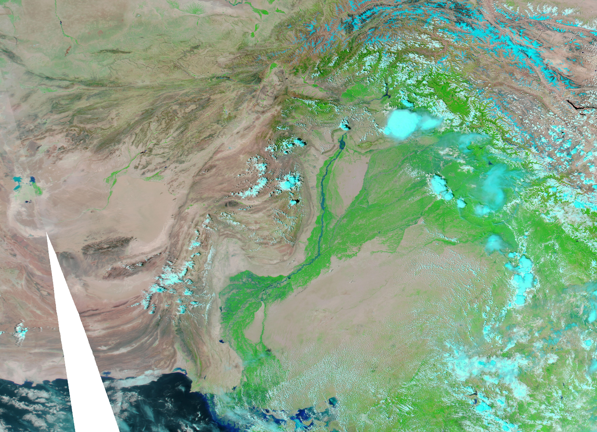
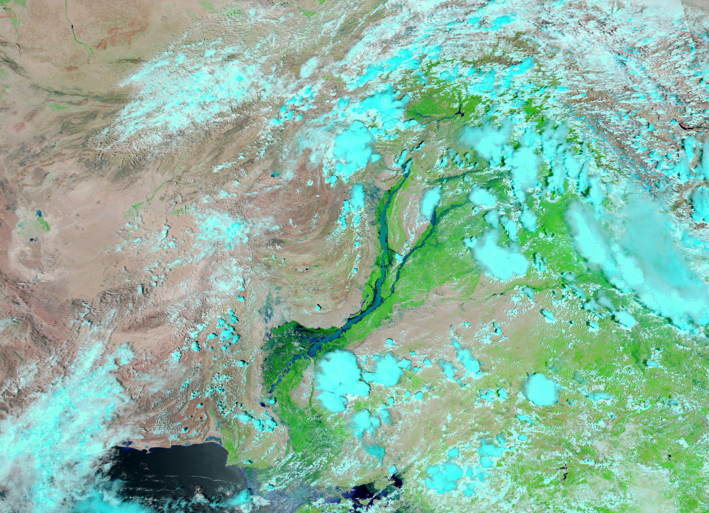
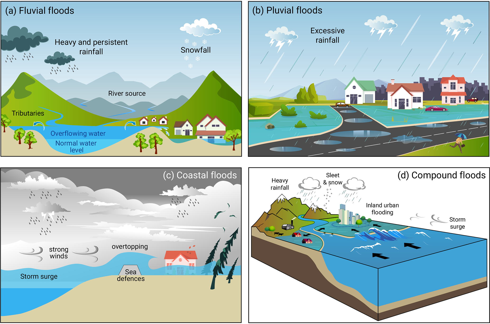
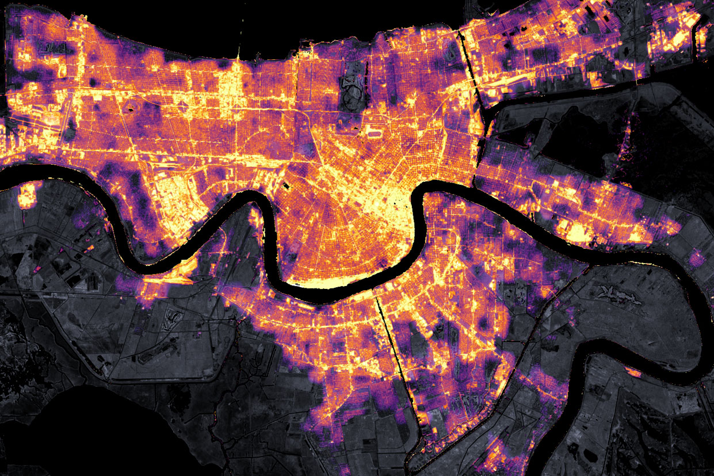
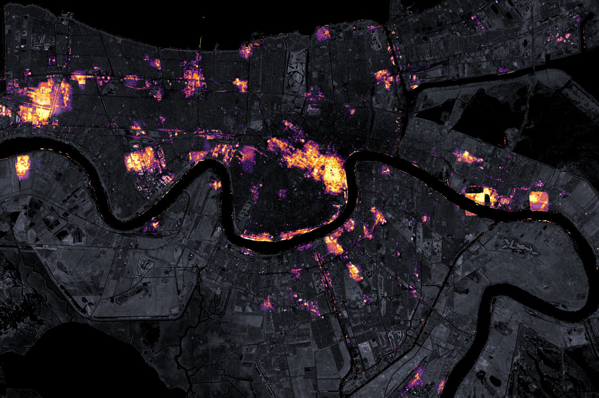
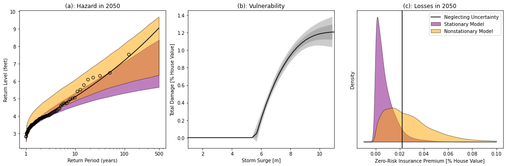
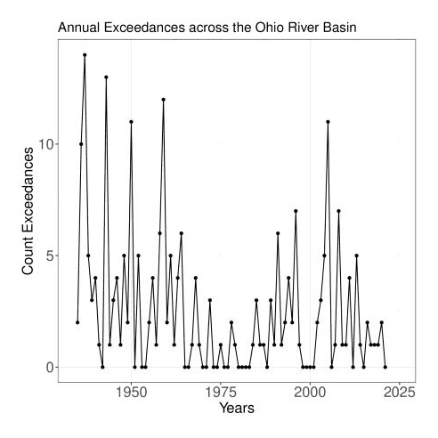

```{julia}
#| echo: false
#| output: false
using CairoMakie, CSV, DataFrames, Dates, Distributions, Printf, Random, Statistics

set_theme!(theme_minimal(); fontsize=20)
colors = Makie.wong_colors()
here = dirname(@__FILE__)
rng = MersenneTwister(543)
```

# Compound events

## Russia, summer 2010

::: {.columns}
::: {.column width="50%"}
{width=100%}
:::
::: {.column width="50%"}
- A dry spring and summer drought exacerbated a heatwave.
- Wildfires followed.
- Global wheat prices rose.
:::
:::

## Spatially co-occurring climate extremes

::: {#fig-indus}
[{height=8cm} {height=8cm}]{}

The Indus River on August 11, 2009 (left) and in flood on August 10, 2010 (right).
NASA images from MODIS Rapid Response Team.
:::


## Compound flooding

::: {.columns}
::: {.column width="40%"}
{height=75%}
:::
::: {.column width="60%"}
- A blocking high steered Hurricane Sandy (2012) into New York from the east.
- The highest storm surge in at least 300 years + spring tide + heavy rainfall + waves
- Damage passed US\$50 billion and 233 people died [@zscheischler_future:2018]
:::
:::

## Sandy reshaped the coast

::: {.callout-note appearance="simple"}
Figure shown in class: New York coast before and after Sandy.
:::

## Most hazards have more than one driver

| Hazard | Climate drivers |
| :--- | :--- |
| Heat stress | Temperature, humidity |
| Fire risk | Temperature, rain, humidity, wind, lightning |
| Coastal flood | River flow, rain, sea level, surge, wind |
| Drought and heat together | Temperature, rain, evaporation, humidity |
| Wind and rain together | Wind, rain, terrain, large-scale circulation |
| Heat and air pollution together | Temperature, sulfur dioxide, nitrogen oxides, particulates |

Abridged from Table 1 of @zscheischler_future:2018 [p. 470], whose first recommendation is that most major weather and climate disasters are caused by several drivers acting together [@zscheischler_future:2018, p. 474].

## Definitions

> "the combination of multiple drivers and/or hazards that contributes to societal or environmental risk" [@zscheischler_future:2018]

Earlier definitions, such as the IPCC special report on extremes [@ipcc_extremeevents:2012], required an extreme impact and dependent drivers.

## Four types of compound event

::: {.columns}
::: {.column width="50%"}
**Preconditioned:** an extreme event does more harm because of initial conditions

```{julia}
#| echo: false
# SCS curve number runoff, in inches, for one storm on dry, average, and wet soil
scs_runoff(rain, cn) = (s=1000 / cn - 10; rain > 0.2s ? (rain - 0.2s)^2 / (rain + 0.8s) : 0.0)
cn_average = 75
cn_by_soil = [
    "Dry soil" => 4.2 * cn_average / (10 - 0.058 * cn_average),
    "Average" => cn_average,
    "Wet soil" => 23 * cn_average / (10 + 0.13 * cn_average),
]
storm_rain = range(0, 8; length=200)
fig = Figure(; size=(520, 330))
ax = Axis(fig[1, 1]; xlabel="Storm rainfall (in)", ylabel="Runoff (in)")
for (i, (label, cn)) in enumerate(cn_by_soil)
    lines!(ax, storm_rain, scs_runoff.(storm_rain, cn); color=colors[i], label=label, linewidth=3)
end
axislegend(ax; position=:lt)
fig
```


:::
::: {.column width="50%"}
**Multivariate:** several drivers act at once.

{height=60%}
:::
:::

## Four types of compound event, continued

::: {.columns}
::: {.column width="50%"}
**Temporally compounding:** one hazard follows another.
Hurricane Ida: wind + heat $\rightarrow$ 35 million customer-hours without power at a heat index above 100°F [@lin_idablackoutheatwave:2024].

::: {#fig-ida}
[{height=3.5cm} {height=3.5cm}]{}

New Orleans at night before (left) and after (right) Ida, 2021.
NASA.
:::
:::
::: {.column width="50%"}
**Spatially compounding:** many connected places at once.

::: {.callout-note appearance="simple"}
Figure shown in class: Clustered extreme rainfall across 40 mining assets, after @bonnafous_waterrisk:2017.
:::
:::
:::

## Examples: preconditioned and multivariate

::: {.columns}
::: {.column width="50%"}
**Preconditioned**

::: {.incremental}
- Rain on saturated or snow-covered ground $\rightarrow$ flood
- Warm late winter, then frost $\rightarrow$ crop loss
- Dry year, then fire season $\rightarrow$ wildfire
:::
:::
::: {.column width="50%"}
**Multivariate**

::: {.incremental}
- Rain + surge + river flow $\rightarrow$ coastal flood
- Heat + drought $\rightarrow$ crop failure, wildfire
- Heat + humidity $\rightarrow$ heat stress
- Wind + rain $\rightarrow$ storm damage
:::
:::
:::

From @zscheischler_typologycompoundweather:2020

## Examples: temporally and spatially compounding

::: {.columns}
::: {.column width="50%"}
**Temporally compounding**

::: {.incremental}
- Storm after storm $\rightarrow$ flood and wind damage before repairs are done
- Heatwave after heatwave $\rightarrow$ health, energy demand, crops
- Flood or hurricane, then heatwave $\rightarrow$ heat exposure without power
:::
:::
::: {.column width="50%"}
**Spatially compounding**

::: {.incremental}
- Floods across a region at once $\rightarrow$ regional trade, emergency response
- Heat or drought in several breadbaskets at once $\rightarrow$ global food system
- Extremes across many insured sites at once $\rightarrow$ (re)insurance
:::
:::
:::

From @zscheischler_typologycompoundweather:2020

# Multi-hazard fragility curves

## Damage and fragility

::: {.columns}
::: {.column width="50%"}
A **damage function**, such as week 1's depth-damage curve, gives the expected loss as a fraction of value at each hazard intensity.


:::
::: {.column width="50%" .pause}
A **fragility function** gives the probability of reaching a damage state, such as a pole breaking, at each hazard intensity.

::: {.callout-note appearance="simple"}
Figure shown in class: Each component of an infrastructure network may have a fragility function.
From @rincon_fragilitymodelingpractices:2024, Fig. 1a.
:::
:::
:::


## A house in a flood: depth and duration

::: {.columns}
::: {.column width="35%"}
More realistic damage assessments depend on more than one hazard, for example flood depth _and_ duration [@nofal_fragility:2020].
:::
::: {.column width="65%"}
::: {.callout-note appearance="simple"}
Figure shown in class: Total building loss as a surface over flood depth and flood duration, from @nofal_fragility:2020, Fig. 16a.
:::
:::
:::


## A utility pole in a hurricane

::: {.columns}
::: {.column width="40%"}
::: {.callout-note appearance="simple"}
Figure shown in class: Wind, surge, and wave loads on a pole. @darestani_woodutility:2022, Fig. 1.
:::
:::
::: {.column width="60%"}
::: {.callout-note appearance="simple"}
Figure shown in class: Probability of pole failure as wind, surge, and wave hazards increase. @darestani_woodutility:2022, Fig. 4.
:::
:::
:::


# Hazard models for compound extremes

## What a fragility surface needs from the hazard model

$$
E[\text{failures}] = \sum_{\text{storms}} P(\text{fail} \mid \text{wind}, \text{surge})
$$

```{julia}
#| echo: false
# a made-up fragility, logistic in wind (m/s) and surge (m)
pole_fragility(wind, surge) = 1 / (1 + exp(-(-14 + 0.25 * wind + 2.0 * surge)))

function correlated_pairs(rng, dependence, n)
    covariance = [1.0 dependence; dependence 1.0]
    return rand(rng, MvNormal([0.0, 0.0], covariance), n)
end

# simulated storms, wind and surge drawn together
storms = correlated_pairs(rng, 0.7, 500)
wind = 30 .+ 8 .* storms[1, :]
surge = max.(0.0, 1.5 .+ 0.8 .* storms[2, :])

fig = Figure(; size=(900, 270))
ax = Axis(fig[1, 1]; xlabel="Peak wind (m/s)", ylabel="Peak surge (m)")
wind_grid, surge_grid = range(5, 60; length=200), range(0, 5; length=200)
contour!(ax, wind_grid, surge_grid, pole_fragility.(wind_grid, surge_grid');
    levels=[0.1, 0.5, 0.9], labels=true, color=:black)
scatter!(ax, wind, surge; color=(colors[1], 0.5), markersize=6)
fig
```

Each point is a storm, and each contour a probability that a pole fails (simulated data).

## The same drivers, different clouds

::: {.callout-note appearance="simple"}
Figure shown in class: Driver distributions over two hazards. @zscheischler_future:2018, Fig. 2.
:::

Under the purple "Future 2" scenario, the distributions of driver 1 and driver 2 barely change, but hazard 1 becomes far greater [@zscheischler_future:2018].

## Dependence

We care about the *joint distribution* of drivers or hazards:

```{julia}
#| echo: false
dependence_cases = [0.7, 0.0, -0.7]
case_labels = ["Move together", "Independent", "Move apart"]

fig = Figure(; size=(1100, 320))
for (i, dependence) in enumerate(dependence_cases)
    pairs = correlated_pairs(rng, dependence, 1500)
    ax = Axis(fig[1, i]; title=case_labels[i], xlabel="Rain (standard units)",
        ylabel=i == 1 ? "Surge (standard units)" : "", aspect=1)
    scatter!(ax, pairs[1, :], pairs[2, :]; color=(colors[i], 0.4), markersize=4)
    limits!(ax, -4, 4, -4, 4)
end
fig
```

## Rain and surge both at their 100-year levels

::: {.callout-tip}
## Think

At a coastal site, you know the 100-year rainfall and the 100-year surge.
How often do both happen in the same year: once in 100 years, once in 10,000, or something else?
:::

## Either or both

Let $A$ be the event that rain passes its 100-year level in a given year, and $B$ the same for surge.
"$A$ or $B$" means at least one happens; "$A$ and $B$" means both happen in the same year.

. . .

At least one is never rarer than either alone, and both is never more common:

$$
P(A \cup B) \ge \max\{P(A), P(B)\}, \qquad P(A \cap B) \le \min\{P(A), P(B)\}
$$

so with return period $T = 1/P$,

$$
T_\text{OR} \le 100 \le T_\text{AND}.
$$

## How rare is "both"?

How far $T_\text{AND}$ sits above 100 years depends on how rain and surge move together:

::: {.incremental}
- If the two always come together, $T_\text{AND} = 100$.
- If they are independent, $P(A \cap B) = P(A) P(B)$, so $T_\text{AND} = 100 \times 100$ years, which is 10,000.
- If they move apart, "both" is rarer still, and $T_\text{AND}$ exceeds 10,000.
:::

## Which return period an engineer needs

The definitions answer different questions [@salvadori_returnperioddesign:2011, p. 3297; @graler_multivariatereturnperiods:2013, p. 1286].

- A pole that fails when wind **or** surge is high needs $T_\text{OR}$.
- A drainage system that fails only when rain falls **and** the outlet is blocked by surge needs $T_\text{AND}$.
- The fragility surface says which combination fails the structure.

## Either and both, by simulation

Each point is one simulated year, and the lines mark each driver's 10-year level.
The 10-year level makes "both" common enough to count; under independence, $T_\text{AND} = 10 \times 10 = 100$ years.

```{julia}
#| echo: false
level_10yr = quantile(Normal(), 0.9)
n_years = 1_000_000

fig = Figure(; size=(1100, 330))
for (i, dependence) in enumerate(dependence_cases)
    pairs = correlated_pairs(rng, dependence, n_years)
    rain_exceeds = pairs[1, :] .> level_10yr
    surge_exceeds = pairs[2, :] .> level_10yr
    T_and = 1 / mean(rain_exceeds .& surge_exceeds)
    T_or = 1 / mean(rain_exceeds .| surge_exceeds)
    ax = Axis(fig[1, i]; title=@sprintf("AND: %.0f yr, OR: %.1f yr", T_and, T_or),
        xlabel="Rain (standard units)", ylabel=i == 1 ? "Surge (standard units)" : "", aspect=1)
    shown = 1:1500
    scatter!(ax, pairs[1, shown], pairs[2, shown]; color=(colors[i], 0.4), markersize=4)
    vlines!(ax, level_10yr; color=:black)
    hlines!(ax, level_10yr; color=:black)
    limits!(ax, -4, 4, -4, 4)
end
fig
```

## A 100-year storm, different floods

{height=80%}

## Many sites at once

::: {.columns}
::: {.column width="50%"}
{height=75%}
:::
::: {.column width="50%"}
- At each gauge, $p=0.1$
- If the 24 gauges were independent, the count would be $\text{Binomial}(24, 0.1)$, which implies $P(\text{count} \geq 10) \approx \frac{1}{20000}$
- Downstream floods depend on *all* the water coming from upstream
:::
:::

## Rare combinations and short records

```{julia}
#| echo: false
level_100yr = quantile(Normal(), 0.99)
record_lengths = [50, 10_000]

fig = Figure(; size=(1000, 290))
for (i, n_years) in enumerate(record_lengths)
    pairs = correlated_pairs(rng, 0.7, n_years)
    n_both = sum((pairs[1, :] .> level_100yr) .& (pairs[2, :] .> level_100yr))
    ax = Axis(fig[1, i]; title="$n_years years, $n_both with both above",
        xlabel="Rain (standard units)", ylabel=i == 1 ? "Surge (standard units)" : "", aspect=1)
    scatter!(ax, pairs[1, :], pairs[2, :]; color=(colors[1], i == 1 ? 0.8 : 0.2),
        markersize=i == 1 ? 8 : 3)
    vlines!(ax, level_100yr; color=:black)
    hlines!(ax, level_100yr; color=:black)
    limits!(ax, -4.5, 4.5, -4.5, 4.5)
end
fig
```

A short record holds few years with both drivers extreme, so tail dependence is hard to estimate.
