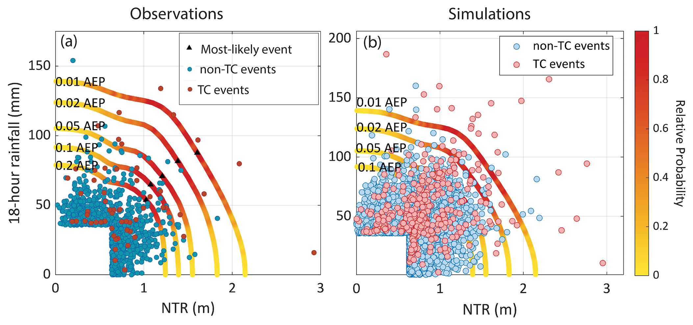

```{julia}
#| echo: false
#| output: false
using CairoMakie, Distributions, LaTeXStrings, Random, Statistics

set_theme!(theme_minimal(); fontsize=20)
colors = Makie.wong_colors()
rng = MersenneTwister(543)

# Pairs on the uniform scale from three copulas that share Kendall's tau
function gaussian_pairs(rng, rho, n)
    z1 = randn(rng, n)
    z2 = rho .* z1 .+ sqrt(1 - rho^2) .* randn(rng, n)
    return cdf.(Normal(), z1), cdf.(Normal(), z2)
end

function t_pairs(rng, rho, nu, n)
    z1 = randn(rng, n)
    z2 = rho .* z1 .+ sqrt(1 - rho^2) .* randn(rng, n)
    scale = sqrt.(rand(rng, Chisq(nu), n) ./ nu)
    return cdf.(TDist(nu), z1 ./ scale), cdf.(TDist(nu), z2 ./ scale)
end

# Survival Clayton, so the tail dependence is in the upper tail
function survival_clayton_pairs(rng, theta, n)
    v = rand(rng, Gamma(1 / theta, 1), n)
    u1 = (1 .+ rand(rng, Exponential(), n) ./ v) .^ (-1 / theta)
    u2 = (1 .+ rand(rng, Exponential(), n) ./ v) .^ (-1 / theta)
    return 1 .- u1, 1 .- u2
end

kendall_tau = 0.5
rho = sin(pi * kendall_tau / 2)
nu = 3
theta_clayton = 2 * kendall_tau / (1 - kendall_tau)

n_pairs = 2_000
corner = 0.95
```

## Equal-exceedance curves and the density along them

{height=85%}

## Copulas with equal Kendall's $\tau$ differ in the upper corner

`{julia} n_pairs` pairs per copula, all with Kendall's $\tau$ = `{julia} kendall_tau`.
The box is where both pass their 95th percentile; independence would put about `{julia} round(Int, n_pairs * (1 - corner)^2)` there.
Adapted from @papalexiou_multisite:2023, Fig. A1.

```{julia}
#| echo: false
samples = [
    "Gaussian" => gaussian_pairs(rng, rho, n_pairs),
    "Student t, ν = $nu" => t_pairs(rng, rho, nu, n_pairs),
    "Survival Clayton" => survival_clayton_pairs(rng, theta_clayton, n_pairs),
]

fig = Figure(; size=(1100, 330))
for (i, (name, (u1, u2))) in enumerate(samples)
    n_corner = sum((u1 .> corner) .& (u2 .> corner))
    ax = Axis(fig[1, i]; title="$name: $n_corner in corner", xlabel=L"U", ylabel=L"V", aspect=1, xticks=[0.5, 1], yticks=[0.5, 1])
    scatter!(ax, u1, u2; color=(colors[i], 0.4), markersize=4)
    lines!(ax, [corner, corner, 1], [1, corner, corner]; color=:black, linewidth=2)
    limits!(ax, 0, 1, 0, 1)
end
fig
```

## "AND" return periods diverge in the tail

All three copulas have Kendall's $\tau$ = `{julia} kendall_tau`, with a million simulated pairs each.
@couasnon_compound:2020, Fig. 7, finds the same pattern for river discharge and storm surge.

```{julia}
#| echo: false
n_sim = 1_000_000
periods = [2, 5, 10, 20, 50, 100]
tail_samples = [
    "Gaussian" => gaussian_pairs(rng, rho, n_sim),
    "Student t, ν = $nu" => t_pairs(rng, rho, nu, n_sim),
    "Survival Clayton" => survival_clayton_pairs(rng, theta_clayton, n_sim),
]

fig = Figure(; size=(1100, 340))
ax = Axis(
    fig[1, 1];
    xlabel="Marginal return period of each driver (years)",
    ylabel="\"AND\" return period (years)",
    xscale=log10,
    yscale=log10,
    xticks=periods,
    yticks=[1, 10, 100, 1000, 10_000],
)
lines!(ax, periods, periods .^ 2; color=:gray, linestyle=:dash, label="Independent")
lines!(ax, periods, periods; color=:black, linestyle=:dot, label="Always together")
for (i, (name, (u1, u2))) in enumerate(tail_samples)
    t_and = [1 / mean((u1 .> 1 - 1 / T) .& (u2 .> 1 - 1 / T)) for T in periods]
    scatterlines!(ax, periods, t_and; color=colors[i], linewidth=3, label=name)
end
axislegend(ax; position=:lt)
fig
```

## Copula families differ in their tails

| Group | Family | Upper tail | Lower tail |
| :--- | :--- | :--- | :--- |
| Elliptical | Gaussian | none | none |
| | Student t | yes | yes, equal |
| Archimedean | Clayton | none | yes |
| | Gumbel | yes | none |
| | Frank | none | none |

Rotating a copula by 180°, using $1 - U$ and $1 - V$, swaps its tails, so survival Clayton has upper tail dependence.
