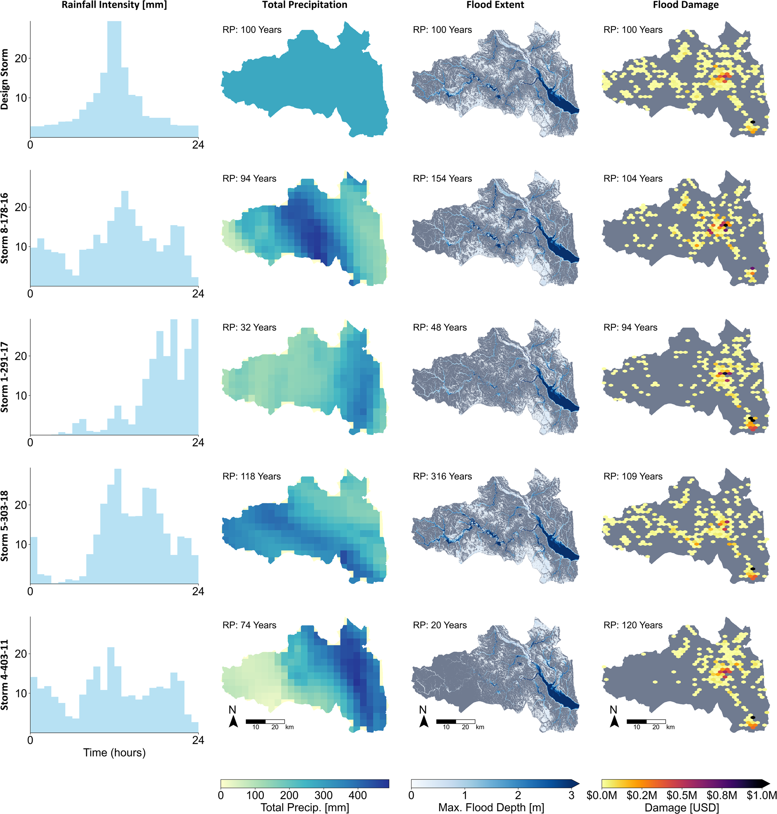
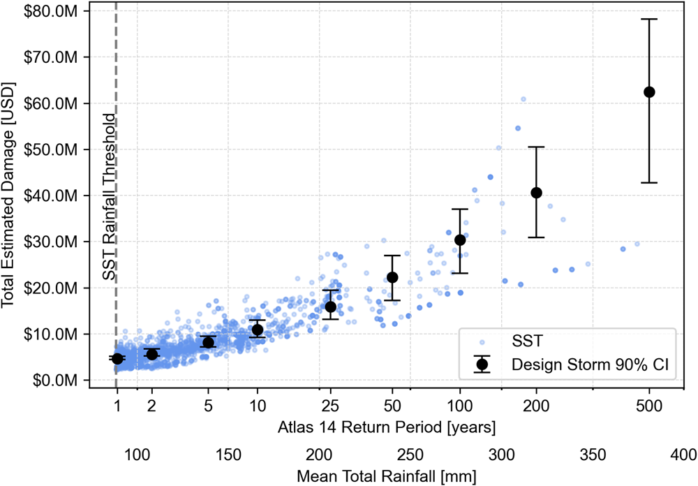

```{julia}
#| echo: false
#| output: false
using CairoMakie, CSV, DataFrames

set_theme!(theme_minimal(); fontsize=20)
here = dirname(@__FILE__)

# Harris County Flood Control District gauge totals for May 25-26, 2015; provenance in week-07-sources.md
storm = CSV.read(joinpath(here, "..", "week-07", "memorial2015-hcfcd.csv"), DataFrame)
```

## What is the distribution of flood losses in a city?

{width=100%}

## Could we fit a GEV or GPD to past flood losses?

{height=90%}

## An event set: realistic events we can compute damage from

| Event | Rate (per year) | Loss (million dollars) |
| ---: | ---: | ---: |
| 1 | 0.002 | 410 |
| 2 | 0.005 | 160 |
| 3 | 0.010 | 95 |
| 4 | 0.040 | 22 |
| $\vdots$ | $\vdots$ | $\vdots$ |

## Memorial Day 2015: where did the rain fall?

```{julia}
#| echo: false
#| fig-cap: "Totals for May 25-26 at Harris County Flood Control District gauges."
let
    fig = Figure(; size=(900, 450))
    ax = Axis(fig[1, 1]; autolimitaspect=1 / cosd(29.8))
    hidedecorations!(ax)
    totals = scatter!(ax, storm.longitude, storm.latitude; color=storm.storm_total_in, colormap=:viridis,
        colorrange=(0, maximum(storm.storm_total_in)), markersize=14)
    # A 10-mile scale bar: one degree of longitude is 69.17 cos(latitude) miles
    bar_lon, bar_lat = minimum(storm.longitude), minimum(storm.latitude)
    lines!(ax, [bar_lon, bar_lon + 10 / (69.17 * cosd(bar_lat))], [bar_lat, bar_lat]; color=:black, linewidth=4)
    text!(ax, bar_lon, bar_lat; text="10 miles", offset=(0, 6), align=(:left, :bottom), fontsize=16)
    Colorbar(fig[1, 2], totals; label="Storm total (inches)")
    fig
end
```

## Where did Memorial Day 2015 flood buildings?

::: {.callout-note appearance="simple"}
Figure shown in class: Buildings flooded in 2015 and 2016, many outside FEMA's high-risk zones. @satija_boomtown:2016.
:::

What was the return period of this flood, and how would it enter average annual loss?

## Where could hurricanes have gone that the record has not seen?

::: {.callout-note appearance="simple"}
Figure shown in class: Historical major hurricane tracks beside simulated tracks from the same coast. @neubergerberman_catmod101:2025, p. 5.
:::

## Where do realistic events come from?

::: {.columns}
::: {.column width="33%"}
**Storm transposition**

This week
:::
::: {.column width="33%"}
**Climate models**

Week 11
:::
::: {.column width="34%"}
**Weather generators**

Week 13
:::
:::

## Does it matter how the storms are built?

{height=80%}

## How much damage do design storms and transposed storms give for the same rainfall?

{height=65%}

Expected annual damage: 14.2 million dollars a year from transposition, 7.4 million more than from design storms [@baer_designstorm:2026, p. 3].
