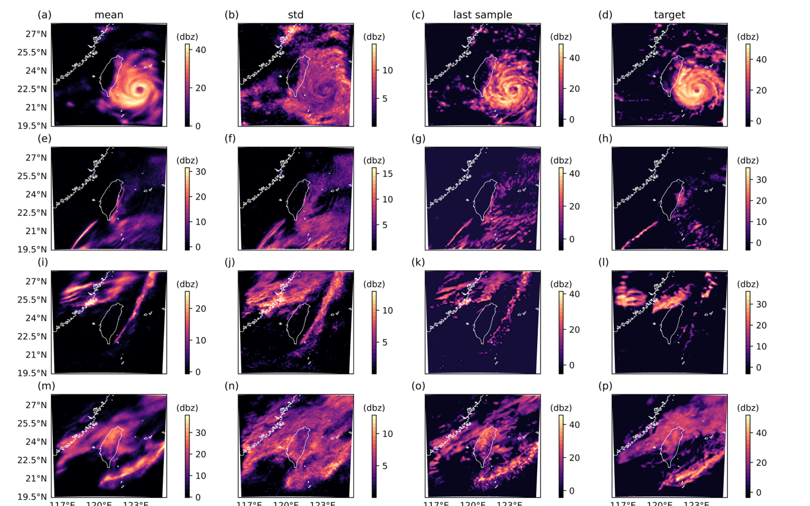
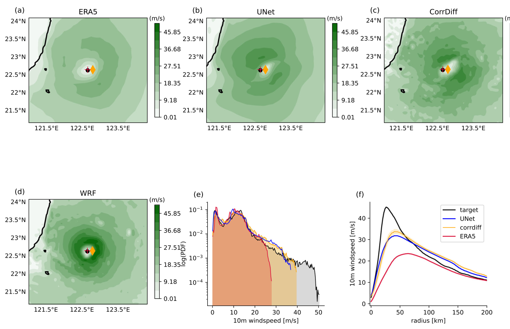

# DeepSD

## Downscaling as image super-resolution

::: {.columns}
::: {.column width="45%"}
::: {.callout-note appearance="simple"}
Figure shown in class: Prism Observed Precipitation: A) Low resolution at 1.0◦ (∼ 100km). B) High resolution at 1/8◦ (∼ 12.5km). @vandal_deepsd:2017, Fig. 1.
:::
:::
::: {.column width="55%"}

- Training:
  - PRISM, United States, 1980-2005.
  - Target: observed rain at 1/8°
  - Predictor: same data coarsened to 1°
- Projection: a climate model's 1° rain, which has no pair
- Ill-posed problem (many possible solutions)
:::
:::

## How DeepSD is trained and used

```{=typst}
#import "@preview/fletcher:0.5.8" as fletcher: diagram, node, edge
#let ink = rgb("#1f3a5f")
#let accent = rgb("#b5452c")
#set text(size: 15pt)
#align(center + horizon, diagram(
  spacing: (10mm, 22mm),
  node-stroke: 1pt + ink,
  node-inset: 8pt,
  node-corner-radius: 3pt,
  node((-1, 0), [*training*], stroke: none),
  node((0, 0), [observed rain \ 1/8°], name: <obs>),
  node((1, 0), [observed rain \ smoothed to 1°], name: <coarse>),
  node((2, 0), [DeepSD \ 1° → 1/2° → 1/4° → 1/8° \ elevation added at each step], name: <net>),
  node((3, 0), [predicted rain \ 1/8°], name: <pred>),
  edge(<obs>, <coarse>, "-|>"),
  edge(<coarse>, <net>, "-|>"),
  edge(<net>, <pred>, "-|>"),
  edge(<pred>, <obs>, "<|-|>", [same day: compare and adjust the network], bend: -25deg, label-side: center),
  node((-1, 1), text(fill: accent)[*projection*], stroke: none),
  node((1, 1), [climate model rain \ 1°], name: <gcm>, stroke: 1pt + accent),
  node((2, 1), [trained DeepSD], name: <net2>),
  node((3, 1), [projected rain \ 1/8°], name: <proj>),
  edge(<gcm>, <net2>, "-|>"),
  edge(<net2>, <proj>, "-|>"),
  node((0, 1), text(fill: accent)[no observed \ rain to compare], stroke: none),
))
```

# CorrDiff

## CorrDiff predicts a mean field, then generates detail

::: {.callout-note appearance="simple"}
Figure shown in class: Regression and diffusion steps from 25 km to 2 km. @mardani_corrdiff:2025, Fig. 6.
:::

- A network predicts the mean 2 km field; a diffusion model samples the detail around it.
- Trained on 3 years over Taiwan, from 25 km reanalysis to a 2 km weather model.
- In: 12 reanalysis variables. Out: 2 m temperature, 10 m winds, and radar reflectivity.

## Generated radar for a typhoon, a front, and two random dates

::: {.columns}
::: {.column width="78%"}
{height=85%}
:::
::: {.column width="22%"}
Rows, top to bottom (UTC):

- Typhoon Haikui, 3 Sep 2023, 00:00
- Random date, 17 Feb 2021, 21:00
- Random date, 4 Mar 2021, 01:00
- Cold front, 13 Feb 2022, 20:00
:::
:::

## Does CorrDiff recover Typhoon Haikui's winds?

::: {.columns}
::: {.column width="65%"}
{height=85%}
:::
::: {.column width="35%"}
Peak wind around the center:

- reanalysis 22 m/s
- CorrDiff 33 m/s
- 2 km model 45 m/s
:::
:::
