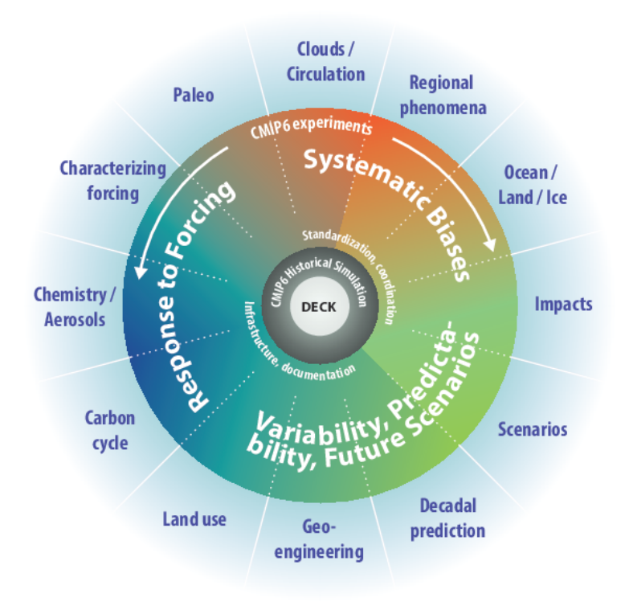

## Can a climate model tell Austin how hard it will rain in 2070?

).](austin-2015-flood.jpg){height=85%}

## Drizzle bias

::: {.columns}
::: {.column width="30%"}
Coarser grids rain more often and more lightly, even in observations
:::
::: {.column width="70%"}
::: {.callout-note appearance="simple"}
Figure shown in class: Tropical rain frequency and intensity against grid size, satellite and 24 models. @chen_drizzlebias:2021, Fig. 4.
:::
:::
:::

## Low resolution obscures important variability

::: {.columns}
::: {.column width="30%"}
Statistical downscaling: learn a relationship between low- and high-resolution data.
:::
::: {.column width="70%"}
::: {.callout-note appearance="simple"}
Figure shown in class: One day of observed rainfall at 1° and at 1/8°. @vandal_deepsd:2017, Fig. 1.
:::
:::
:::

## Dynamical downscaling: regional models inside a global one

::: {.callout-note appearance="simple"}
Figure shown in class: UK winter rainfall from a 300 km model, two regional models, and 5 km observations. @maraun_downscaling:2010, Fig. 1.
:::

## Bias correction: a climate model against one station in Kenya

::: {.callout-note appearance="simple"}
Figure shown in class: ECHAM against a Katumani gauge: too many wet days, each too light. @ines_biascorrection:2006, Fig. 1.
:::

## Correcting weather forecasts and climate projections

::: {.columns}
::: {.column width="20%"}
:::
::: {.column width="40%"}
**Weather forecast**
:::
::: {.column width="40%"}
**Climate projection**
:::
:::

. . .

::: {.columns}
::: {.column width="20%"}
Goal
:::
::: {.column width="40%"}
$\hat{x}_t \approx x_t$: the corrected value matches what happened on day $t$
:::
::: {.column width="40%"}
$p_{\hat{X}} \approx p_X$: the corrected values have the observed distribution
:::
:::

. . .

::: {.columns}
::: {.column width="20%"}
Source of bias
:::
::: {.column width="40%"}
right starting state, slightly wrong dynamics
:::
::: {.column width="40%"}
a different dynamical system, running on its own
:::
:::

# Reading CMIP data

## Reading a CMIP6 file path

```text
CMIP6/ScenarioMIP/DKRZ/MPI-ESM1-2-HR/ssp585/r1i1p1f1/3hr/tas/gn/v20190710
```

| Part | Meaning |
| :--- | :--- |
| `DKRZ` | modeling center: German Climate Computing Center |
| `MPI-ESM1-2-HR` | model |
| `ssp585` | experiment: scenario SSP5-8.5 |
| `r1i1p1f1` | ensemble member 1 |
| `3hr`, `tas` | every 3 hours, near-surface air temperature |

## Modeling centers and models

).](kuma-2023-genealogy.png){height=90%}

## Every model runs the same core experiments

{height=80%}

## Scenarios: the same futures for every model

::: {.callout-note appearance="simple"}
Figure shown in class: Global warming under five scenarios, CMIP6 models. @intergovernmentalpanelonclimatechange_wgi:2023, Fig. SPM.8a.
:::

## Models and ensembles

::: {.columns}
::: {.column width="55%"}
::: {.incremental}

- **Multi-model ensemble** (CMIP): many models, a few runs each; spread shows how models differ.
- **Initial-condition large ensemble**: one model, many runs with random noise ($10^{-14}$ K) to study internal variability [@kay_cesmle:2015].
- **Perturbed-physics ensemble**: one model, uncertain parameters varied; spread shows parameter uncertainty [@stainforth_climateensembleinterpretation:2007].

:::
:::
::: {.column width="45%"}
::: {.callout-note appearance="simple"}
Figure shown in class: Winter temperature trends, 1979-2012: 30 runs of one model, their mean, observations. @kay_cesmle:2015, Fig. 4.
:::
:::
:::
