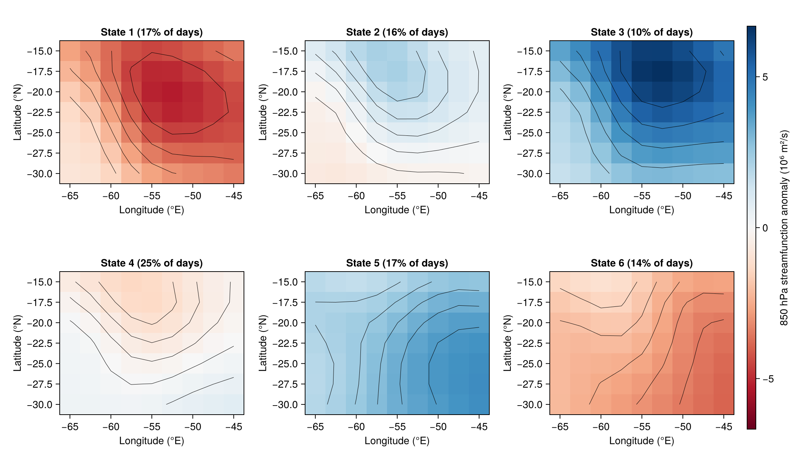
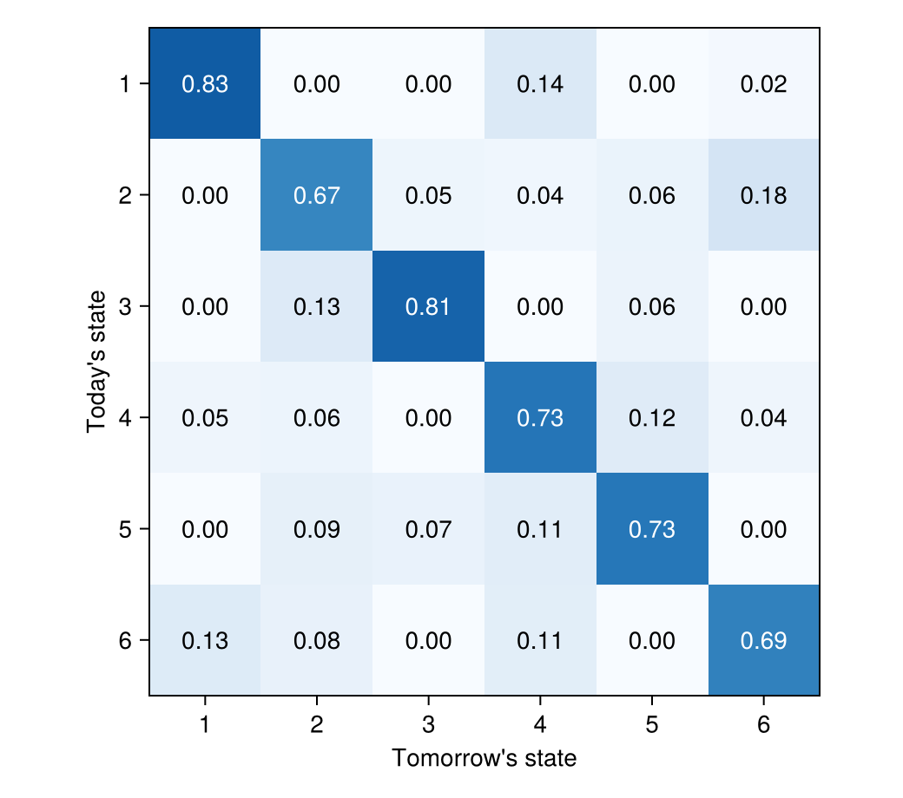
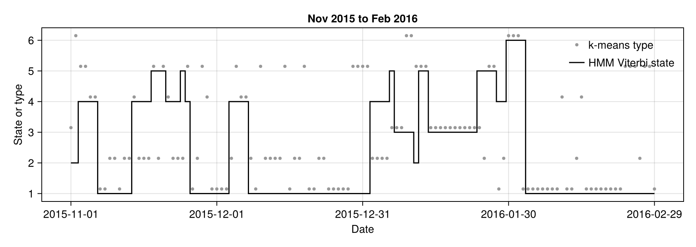
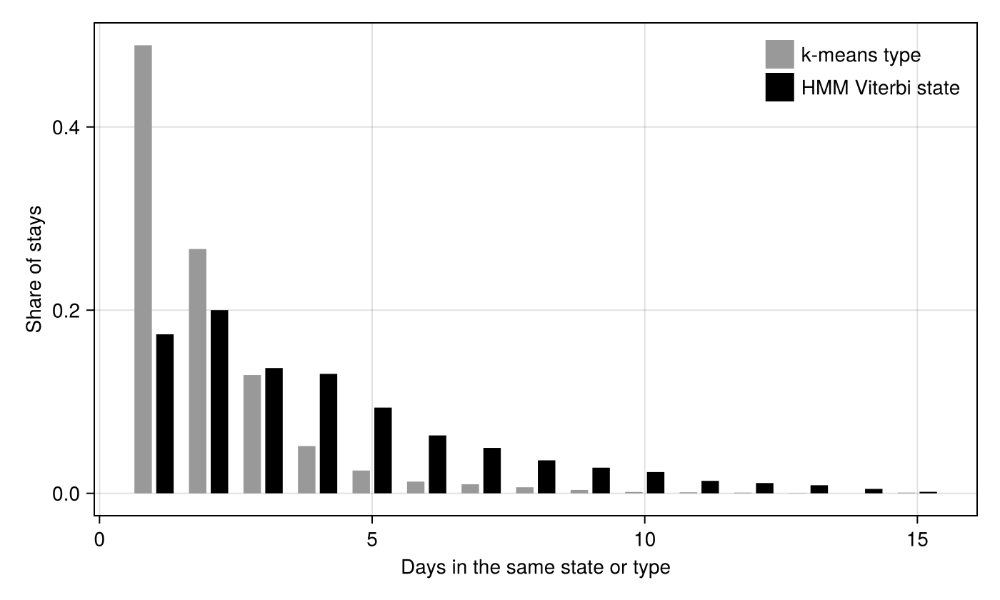
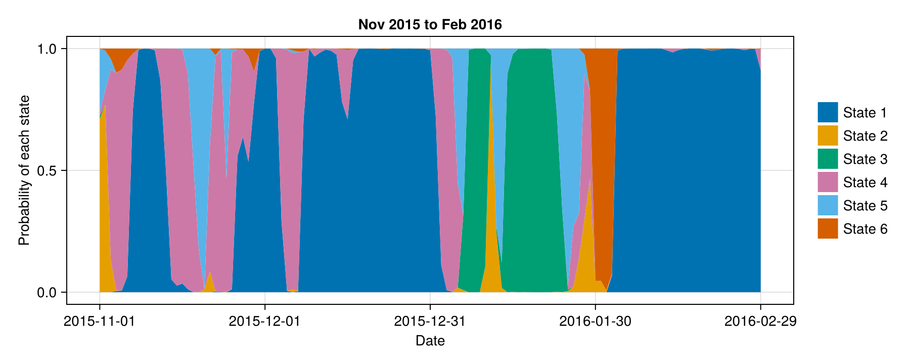

# Wet and Dry Days

## Weather with and without Memory

```{=typst}
#import "/lectures/week-13/markov-chains-sketches.typ": *
#align(center + horizon, scale(180%, reflow: true, sketch-sequences))
```

Same wet fraction; in the Markov chain, tomorrow's chance of rain depends on today

## How Long Do Dry Spells Last?

```{=typst}
#import "/lectures/week-13/markov-chains-sketches.typ": *
#align(center + horizon, scale(190%, reflow: true, sketch-spells))
```

Chance a dry spell lasts 7 days or more: 0.26 with memory, 0.088 without

# Hidden Coins

## Hidden Regimes and the Rain They Produce

```{=typst}
#import "/lectures/week-13/markov-chains-sketches.typ": *
#align(center + horizon, scale(150%, reflow: true, sketch-hidden))
```

Where did the coin change?

## Which Regime Were the Dry Days In?

```{=typst}
#import "/lectures/week-13/markov-chains-sketches.typ": *
#align(center + horizon, scale(190%, reflow: true, sketch-posterior))
```

$P(\text{stormy})$ on the dry days, with 1, 2, or 3 in a row: 0.93, 0.73, 0.35-0.43

# Paraguay Weather Types

## Data

- 850 hPa streamfunction, 15-30°S, 65-45°W, Nov-Feb 1979-2025 (NCEP-DOE Reanalysis 2)
- Four leading PCs, as last week; six states
- Each state: normal on the four PCs, started from k-means types like last week's
- State numbers are not the type numbers in @doss-gollin_pyfloods:2018

## Six States

{height=65%}

Which states are near opposites?

## How Long Does Each State Last?

::: {.columns}
::: {.column width="55%"}
{height=6.5cm}
:::
::: {.column width="45%"}

- Mean stay: $1/(1 - p_{ii})$
- State 1: about 6 days
- State 2: about 3 days
- Which states almost never follow each other?

:::
:::

## The 2015-16 Season

{width=100%}

Which gives longer spells?

## Stay Lengths

{height=75%}

Mean stay: 4.5 days (HMM states), 2.1 days (k-means types)

## How Sure Is Each Day's State?

{width=75%}

Where are the near ties?

## For Wednesday

Read @greene_nhmm:2011 and come ready to discuss:

- Which climate model output does the NHMM use, and which does it distrust?
- Why do the states alone give less monsoon rain while the models give more?
