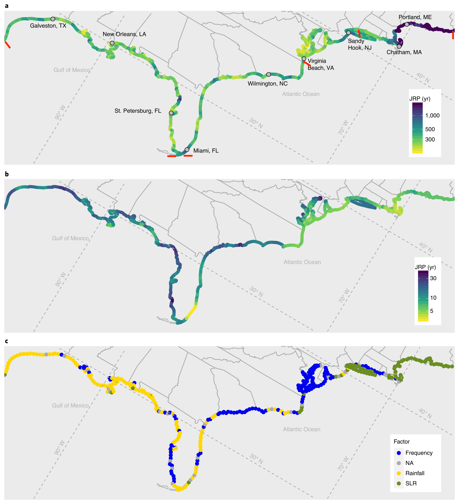

## Will the Reservoir Run Dry?

, [CC BY-SA 4.0](https://creativecommons.org/licenses/by-sa/4.0).](reservoir.jpg){height=90%}

## Three Ways to Get Future Weather

| | From the climate model | From the observed record |
| :--- | :--- | :--- |
| Bias correction | local daily rainfall, corrected | the correction |
| Weather generator | large-scale drivers | local weather on each kind of day |
| Fit the record | nothing | everything |

## Stochastic Weather Generators

- Synthetic weather with the observed statistics [@wilks_weathergeneration:1999]
- Thousands of years from a few decades of data
- Drives a system model: reservoir, crop, levee, insurance portfolio

## Stress-Testing a Water Supply

::: {.callout-note appearance="simple"}
Figure shown in class: Water supply planning under temperature, rainfall, and demand change. @steinschneider_expanded:2015, Fig. 8.
:::

## What Weather Types Missed

- Senegal: types got rainfall distributions right [@moron_senegal:2008]
- Spell lengths depend on which type follows which

## A Regime-Based Generator

::: {.callout-note appearance="simple"}
Figure shown in class: ENSO drives weather regimes, which drive resampled local weather. @steinschneider_generator:2019, Fig. 2.
:::

## Does It Reproduce the Record?

::: {.callout-note appearance="simple"}
Figure shown in class: Observed against simulated daily statistics, Tuolumne basin. @steinschneider_generator:2019, Fig. 9.
:::

Means and variances match; dry spells too short

## Where Could Hurricanes Go?

::: {.callout-note appearance="simple"}
Figure shown in class: Historical major hurricane tracks beside simulated tracks from the same coast. @neubergerberman_catmod101:2025, p. 5.
:::

Tens of thousands of synthetic years

## Synthetic Hurricanes in a Warmer Climate

{height=60%}

Storms simulated in conditions from reanalysis (5,018 storms, 1980-2005) or from eight CMIP6 models (6,200 each, 2070-2100)

## What These Generators Share

A data-driven model, conditioned on what climate models simulate credibly

| | Conditioned on | Data-driven model | How |
| :--- | :--- | :--- | :--- |
| Tuolumne basin generator | Niño 3.4 | weather regimes, then observed days resampled within each regime | Niño 3.4 shifts how regimes follow one another |
| Synthetic hurricanes | large-scale winds, ocean temperature, humidity | random storm seeds, steered by synthetic winds | steering winds drawn with the climate's monthly statistics |

## Today

- Markov chains: weather with memory
- Hidden Markov models (HMMs): regimes you never observe
